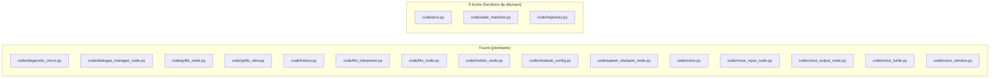
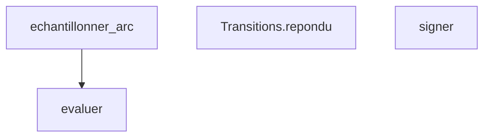

# Énoncé - Devoir2

## Objectif

Faire dialoguer, par la voix et un LLM, une machine d'états qui pilote turtlesim à travers un système ROS2 à six nœuds.

## Prérequis

- L'environnement conda ihr est actif, avec ROS2 Humble installé (canal robostack-humble).
- ROS_LOCALHOST_ONLY=1 et ROS_DOMAIN_ID sont définis avant tout lancement ROS2.
- Un démon Ollama sert un modèle texte pour l'interprétation LLM.

Vérifier l'environnement :

```
envs\ihr\python.exe -c "import rclpy, geometry_msgs.msg, turtlesim.msg"
```

## Architecture : fourni contre à écrire



## Fonctions à implémenter

| Fonction | Fichier | Indice | Tests |
| --- | --- | --- | --- |
| `echantillonner_arc` | `code/arcs.py` | integrer x, y, theta par Euler explicite (modele unicycle) et tester la collision avant chaque pas | `test_arc_dont_le_segment_etait_libre_est_refuse`, `test_arc_entre_dans_l_obstacle_est_detecte`, `test_arc_frole_l_obstacle_sans_le_toucher` |
| `Transitions.repondu` | `code/state_machine.py` | l'etat courant decide ou mene un refus ; SORTIE et INDECIS d'abord | `test_refus_en_confirmation_commande_renvoie_a_ecoute_jamais_a_interpretation`, `test_refus_en_confirmation_action_renvoie_a_interpretation_jamais_a_ecoute` |
| `signer` | `code/state_machine.py` | convention REP-103 : antihoraire positif, horaire negatif | `test_signer_is_forward_vrai_rend_une_vitesse_lineaire_positive`, `test_signer_is_clockwise_vrai_rend_une_vitesse_angulaire_negative` |
| `evaluer` | `code/trajectory.py` | trois phases : montee (a*t), plateau (vitesse de crete constante), descente (temps restant) | `test_evaluer_ecrete_avant_le_depart_et_apres_la_fin`, `test_vitesse_nulle_aux_deux_bouts`, `test_vitesse_maximale_respectee` |

## Logigramme des fonctions et de leurs appels

L'ordre d'implémentation se lit sur la figure : traiter les feuilles (aucune flèche sortante) avant les fonctions qui les appellent.



## Marche à suivre

1. Lancer la suite de tests du travail et lire la liste des échecs.
2. Choisir une FEUILLE du logigramme ci-dessus (un nœud sans flèche sortante) : une
   fonction qui n'en appelle aucune autre parmi celles à implémenter se termine toujours
   en premier, avant celles qui en dépendent.
3. Ouvrir le fichier source à l'endroit indiqué, lire le docstring complet (Purpose,
   Inputs, Outputs) : c'est le contrat exact à respecter.
4. Lire les tests cités pour cette fonction : ils donnent les cas concrets attendus.
5. Écrire l'implémentation, à l'indentation déjà en place.
6. Relancer la suite et itérer jusqu'à ce que CETTE fonction seule passe tous ses tests.
7. Remonter au nœud suivant du logigramme, jusqu'à ce que la suite complète soit verte.

## Pièges connus

- L'égalité stricte sur la réponse de l'utilisateur rejette « oui c'est correct » si seul « oui » est attendu : il faut chercher un mot, pas comparer toute la phrase.
- Un seul message de consigne ne suffit pas : turtlesim oublie sa dernière commande de vitesse au bout d'une seconde sans republication.
- Commander la vitesse linéaire ET la vitesse angulaire en même temps décrit un arc, et un arc peut entrer dans un obstacle que le segment direct évitait.

## Résultats attendus

- La suite Devoir2/test passe intégralement.
- Une commande vocale complète (transcription, interprétation, confirmation, exécution) fait avancer ou tourner la tortue turtlesim.

## Contenu du rapport

| Section | Points |
| --- | --- |
| Introduction et contexte | 8 |
| Bibliothèques utilisées | 7 |
| Méthode utilisée | 15 |
| Schéma bloc de la solution | 10 |
| Logigramme des fonctions | 15 |
| Explications du code | 10 |
| Tests du programme | 15 |
| Résultats et mesures | 10 |
| Discussion et limites | 5 |
| Conclusion | 3 |
| Références et hygiène | 2 |
| **Total** | **100** |
